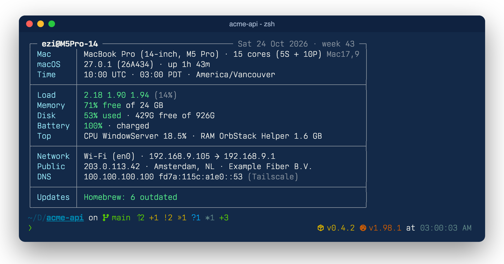
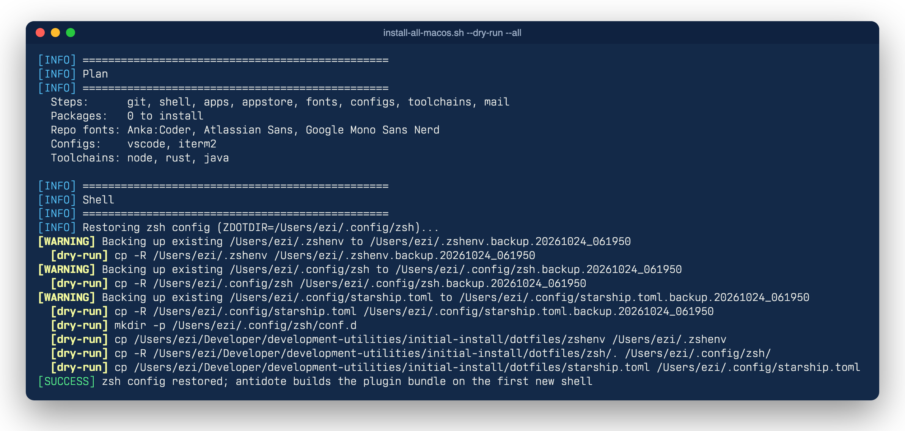
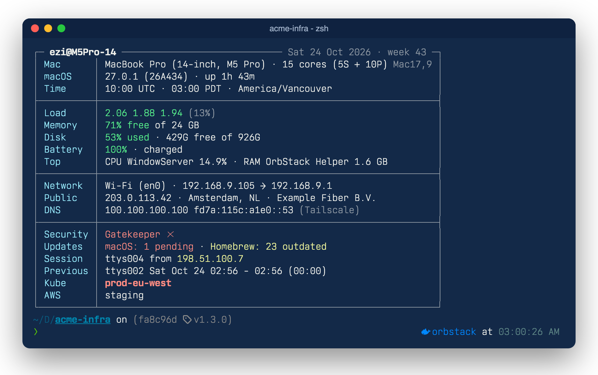
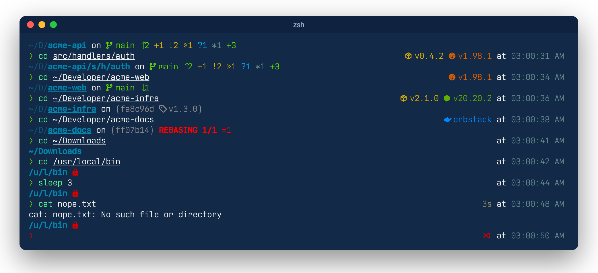

# macOS Development Environment Setup Script

A zsh script that restores my macOS setup on a new (or existing) Mac: Homebrew formulae and apps, App Store apps, fonts, the zsh configuration, Git, VS Code and iTerm2 settings, and dev toolchains. **Everything is chosen at runtime** from checklists, so you can skip any step and any individual app.

The restored shell opens every terminal with a one-table system summary and a starship prompt that shows git and project details at a glance:



## Contents

- [Features](#features)
- [Prerequisites](#prerequisites)
- [Quick Start](#quick-start)
- [What Happens During Installation](#what-happens-during-installation)
- [Files](#files)
- [The App Manifest (`packages.conf`)](#the-app-manifest-packagesconf)
- [Keeping It Up To Date](#keeping-it-up-to-date)
- [Shell Configuration](#shell-configuration)
- [Terminal Greeting (`motd`)](#terminal-greeting-motd)
- [Prompt (starship)](#prompt-starship)
- [Git Configuration](#git-configuration)
- [Troubleshooting](#troubleshooting)
- [Backup Recovery](#backup-recovery)

## Features

✅ **Pick what you want** - Checklists for every step and every app category; untick anything you don't need  
✅ **Questions first** - All choices are made up front, then the install runs unattended  
✅ **Safe to re-run** - Already-installed apps are detected (including apps installed by hand) and skipped  
✅ **Automatic Backups** - Existing configs are copied to `*.backup.YYYYmmdd_HHMMSS` before being replaced  
✅ **Keeps going on failure** - A failed package is recorded and shown in the summary instead of aborting the run  
✅ **Dry run** - `--dry-run` prints every command without changing anything  
✅ **Snapshot** - `--snapshot` refreshes the repo copy of the config and app list from the current Mac  
✅ **Terminal greeting** - A system summary table in every new terminal, showing only what's useful  
✅ **Informative prompt** - Git change counts, rebase progress, project versions and an abbreviated path

## Prerequisites

- **macOS** (Apple Silicon or Intel)
- **Active internet connection**
- **Administrator privileges** (for Homebrew)
- **Signed in to the App Store** if you want the App Store apps

Xcode Command Line Tools, Homebrew and [gum](https://github.com/charmbracelet/gum) (used for the checklists) are installed automatically.

## Quick Start

```bash
cd initial-install
./install-all-macos.sh             # interactive install
./install-all-macos.sh --dry-run   # see what would happen, change nothing
./install-all-macos.sh --all       # no questions: install everything marked "on"
./install-all-macos.sh --snapshot  # refresh dotfiles/ and packages.conf from this Mac
./install-all-macos.sh --help      # print the usage
```

In the checklists: **space** toggles an item, **enter** confirms, **ctrl+c** aborts.

### Options in detail

| Option | What it does | When to use it |
|---|---|---|
| *(none)* | Asks which steps to run, your Git identity and which apps to install, shows the plan, then installs | Setting up a Mac |
| `--dry-run` | Goes through the same questions, then prints each command prefixed with `[dry-run]` instead of running it | Checking what a run would change |
| `--all` | Asks nothing: every step runs and every package marked `on` in `packages.conf` is installed. The Git step uses your existing global identity, or is skipped if there is none | Unattended installs, scripting |
| `--dry-run --all` | Prints the full unattended plan without asking or changing anything | A quick preview |
| `--snapshot` | Copies the current Mac's config back into the repo (see [Keeping It Up To Date](#keeping-it-up-to-date)) | After changing your setup |

A dry run prints the plan, then every backup and copy the restore would make:



### Examples

```bash
# Fresh Mac: clone the repo and run everything interactively
git clone https://github.com/eugenezimin/development-utilities.git ~/Developer/development-utilities
cd ~/Developer/development-utilities/initial-install
./install-all-macos.sh

# Only restore the shell: untick everything except "shell" in the first checklist,
# or preview it without touching anything
./install-all-macos.sh --dry-run

# Install everything marked "on" with no questions, and keep a log
./install-all-macos.sh --all 2>&1 | tee ~/setup.log
```

## What Happens During Installation

1. **Preflight** - macOS check, Xcode Command Line Tools
2. **Homebrew** - installed or updated, then `gum`
3. **Choose steps** - all preselected:

   | Step | What it does |
   |---|---|
   | `git` | Writes `~/.gitconfig` (aliases below) with your name/email, adds `~/.gitignore` if missing |
   | `shell` | Restores the zsh config from `dotfiles/` (antidote, starship, greeting) and creates `~/.hushlogin` |
   | `apps` | Homebrew formulae and casks, one checklist per category |
   | `appstore` | App Store apps via `mas` |
   | `fonts` | Nerd Font casks and the fonts in [`../nerd-fonts`](../nerd-fonts) |
   | `configs` | VS Code settings, keybindings and extensions from [`../vscode-configuration-dark`](../vscode-configuration-dark); iTerm2 prefs from [`../iterm2-config`](../iterm2-config) |
   | `toolchains` | Node 20 + 24 via nvm (with pnpm and serverless@3), Rust via rustup (with cargo-deny and cargo-nextest), Oracle JDK 25 reminder |
   | `mail` | Runs [`../mail-reminder/install.sh`](../mail-reminder) |

4. **Git identity** - name and email, prefilled from your current global Git config
5. **Choose apps** - one checklist per category; apps already on the Mac are listed but not offered. Then checklists for the App Store apps, repo fonts, configs and toolchains of the steps you picked
6. **Confirm** - shows the plan, then installs
7. **Summary** - what was installed, what failed, and manual follow-ups (for example "Add API keys and tokens to `~/.config/zsh/.zsh_secrets`")

## Files

```
initial-install/
├── install-all-macos.sh        # the script
├── packages.conf               # app manifest: categories, packages, defaults
├── screenshots/                # images used in this README
└── dotfiles/
    ├── zshenv                  # → ~/.zshenv (sets ZDOTDIR=~/.config/zsh)
    ├── starship.toml           # → ~/.config/starship.toml (prompt)
    ├── gitignore               # → ~/.gitignore (only if missing)
    └── zsh/                    # → ~/.config/zsh
        ├── .zshenv             # every zsh: EDITOR, cargo and ~/.local/bin env
        ├── .zprofile           # login shells: Homebrew, OrbStack, PATH order
        ├── .zshrc              # interactive shells: loads everything below
        ├── .zsh_plugins.txt    # antidote plugin list
        ├── plugins.zsh         # loads the plugins
        ├── prompt.zsh          # starts starship (or p10k) and computes the prompt path
        ├── .p10k.zsh           # Powerlevel10k config, used with ZSH_PROMPT=p10k
        └── conf.d/
            ├── 10-options.zsh
            ├── 20-env.zsh
            ├── 30-aliases.zsh
            ├── 40-functions.zsh
            ├── 50-tools.zsh
            ├── 60-ghostty-title.zsh
            └── 90-motd.zsh     # terminal greeting
```

## The App Manifest (`packages.conf`)

One package per line:

```
# category | type | id | description | default
Dev Apps   | cask    | visual-studio-code | Visual Studio Code | on
CLI Tools  | formula | lsd                | ls with colours    | on
App Store  | mas     | 441258766          | Magnet             | on
Manual     | manual  | pgModeler          | https://pgmodeler.io/download | -
```

- **type**: `formula`, `cask`, `mas` (App Store ID) or `manual` (shown as a reminder only)
- **default**: `on` is preselected in the checklist, `off` is listed but unticked
- Categories appear in the order they're first used; `App Store`, `Fonts` and `Manual` have their own steps
- Descriptions must not contain commas

To add an app, add a line. To find an App Store ID: `mdls -name kMDItemAppStoreAdamID /Applications/Name.app`.

### Examples

```
# A new category gets its own checklist, shown after the existing ones
Databases  | cask    | dbngin             | Local database servers | on

# Listed but unticked by default
CLI Tools  | formula | hyperfine          | Command benchmarking   | off

# Not installable automatically: shown in the summary as a reminder
Manual     | manual  | Some Vendor App    | https://example.com/download | -
```

## Keeping It Up To Date

After changing your shell config or installing new apps, run:

```bash
./install-all-macos.sh --snapshot
git diff
```

This copies `~/.config/zsh`, `~/.zshenv`, `~/.config/starship.toml` and `~/.gitignore` into `dotfiles/`, saves the VS Code extension list, and appends any installed packages missing from `packages.conf` under `Uncategorized` (move them into a proper category). It warns if anything that looks like a secret ended up in `dotfiles/`.

A typical round trip:

```bash
micro ~/.config/starship.toml          # tweak the prompt on this Mac
exec zsh                               # try it
./install-all-macos.sh --snapshot      # copy it into the repo
git diff dotfiles/starship.toml        # review
git commit -am "Tweak prompt colours"
```

## Shell Configuration

The zsh config lives in `~/.config/zsh` (`ZDOTDIR`), loaded by `~/.zshenv`.

### Load order

| # | File | Runs for | What it does |
|---|---|---|---|
| 1 | `~/.zshenv` | every zsh | Sets `ZDOTDIR=~/.config/zsh` and sources the one there |
| 2 | `.zshenv` | every zsh | `EDITOR=micro`, cargo and `~/.local/bin` environments. Kept fast and silent |
| 3 | `.zprofile` | login shells | `brew shellenv`, OrbStack tools, keeps `~/.local/bin` first in `PATH` |
| 4 | `.zshrc` | interactive shells | Picks the prompt engine (`ZSH_PROMPT`), then loads 5–8 |
| 5 | `.zsh_secrets` | interactive shells | Your API keys and overrides (chmod 600, never copied into the repo) |
| 6 | `plugins.zsh` | interactive shells | antidote loads `.zsh_plugins.txt` |
| 7 | `conf.d/*.zsh` | interactive shells | Personal config, in file-name order |
| 8 | `prompt.zsh` | interactive shells | Starts starship (default) or Powerlevel10k |

Restoring copies files over the existing directory, so history, sessions and `.zsh_secrets` are kept. A previous `~/.zshrc` is no longer read once `ZDOTDIR` is set.

### Plugins

**antidote** builds a static bundle from `.zsh_plugins.txt` and rebuilds it only when the list changes. Run `antidote update` to update all plugins.

- Oh My Zsh lib files (completion, directories, grep, history, key-bindings, misc, theme-and-appearance) and plugins (git, colored-man-pages, colorize, jsontools, macos), without the framework
- **zsh-autocomplete** - completion menu as you type
- **zsh-syntax-highlighting** - colours commands and paths as you type; must stay last
- **powerlevel10k** - only cloned; used when `ZSH_PROMPT=p10k`

### `conf.d/`

| File | Contents |
|---|---|
| `10-options.zsh` | Shell options; raises the open-files limit (`ulimit -n 4096`) |
| `20-env.zsh` | `JAVA_HOME` from `/usr/libexec/java_home`, `NVM_DIR` |
| `30-aliases.zsh` | Aliases (below) |
| `40-functions.zsh` | `ftext [pattern] [dir] [prune]` - find files by name, e.g. `ftext '*.toml' ~/Developer` |
| `50-tools.zsh` | nvm from Homebrew |
| `60-ghostty-title.zsh` | Tab title `folder - branch - command`, e.g. `acme-api - main - cargo` |
| `90-motd.zsh` | The [terminal greeting](#terminal-greeting-motd) |

To add your own config, drop a new `NN-name.zsh` file into `~/.config/zsh/conf.d/`, then run `--snapshot` to keep it.

### Aliases

| Alias | Runs |
|---|---|
| `ll` / `la` | `lsd -l` / `lsd -l -A`, folders first |
| `python`, `python3` | `uv run python` |
| `nano` | `micro` |
| `pd` | `podman` |
| `zshconfig` | `micro $ZDOTDIR` |
| `clear` | clears the screen and the scrollback |

**Secrets** go in `~/.config/zsh/.zsh_secrets` (chmod 600). It is never copied into the repo; the script creates an empty one. Because it loads before `conf.d/`, it's also the place for personal overrides such as the greeting settings below.

## Terminal Greeting (`motd`)

`conf.d/90-motd.zsh` prints a summary table once in every new terminal tab or window, just before the first prompt. Each fact appears once, and rows that are normally fine only show up when they need attention. Run `motd` any time to print it again.

### What a normal day looks like

The [screenshot at the top](#macos-development-environment-setup-script) shows a typical greeting. The title bar shows `user@ComputerName` and the date with its ISO week. The rows are grouped into sections:

| Row | Shows | Source |
|---|---|---|
| **Mac** | Model name, chip (when the model name doesn't already include it), cores with their performance split, model ID | `ioreg`, `sysctl` |
| **macOS** | Version, build, uptime | `sw_vers`, `kern.boottime` |
| **Time** | UTC, local time and the time zone name | zsh `strftime`, `/etc/localtime` |
| **Load** | 1/5/15-minute load average and the 1-minute load as a share of all cores | `vm.loadavg` |
| **Memory** | Memory still available and total RAM; swap only when it's in use | `kern.memorystatus_level`, `vm.swapusage` |
| **Disk** | Used share, free and total space of the Data volume (where your files live) | `df` |
| **Battery** | Charge, state, time left, cycle count and health. Hidden on desktops | `pmset`, `ioreg AppleSmartBattery` |
| **Top** | The busiest process by CPU and the largest by memory | `ps` |
| **Network** | Connection type (Wi-Fi, Ethernet, VPN), interface, local address → router | `route`, `networksetup`, `ipconfig` |
| **Public** | Public IP, city, country and ISP | [ipinfo.io](https://ipinfo.io) |
| **DNS** | Resolvers, only when they aren't simply your router (custom DNS, VPN, Tailscale) | `scutil --dns` |

Values are coloured green, yellow or red:

| Value | Yellow | Red |
|---|---|---|
| Load (share of cores) | ≥ 70% | ≥ 100% |
| Memory available | ≤ 30% | ≤ 15% |
| Disk used | ≥ 80% | ≥ 90% |
| Battery charge | ≤ 30% | ≤ 15% |
| Battery health | ≤ 85% | ≤ 80% |
| Homebrew outdated | ≥ 10 | ≥ 50 |

### When something needs attention

Extra rows appear in a last section only when they apply. Here the session is over SSH, Gatekeeper is off, updates are waiting and Kubernetes points at production:



| Row | Appears when |
|---|---|
| **Security** | FileVault, Firewall, SIP or Gatekeeper is off. Lists only the ones that are off |
| **Updates** | macOS updates are pending or Homebrew packages are outdated |
| **Session** / **Previous** | You're connected over SSH: your tty, the client address and the previous login |
| **Logins** | Other users or remote sessions are logged in |
| **Tunnel** | `sshuttle` is running |
| **Kube** | A Kubernetes context is set in `$KUBECONFIG` or `~/.kube/config`. Bold red if its name contains `prod` |
| **AWS** | `$AWS_PROFILE` is set. Bold red if it contains `prod` |

### Speed and caching

The greeting takes about 0.1 s. Slow lookups are cached in `~/.cache/motd/`:

| Cache file | Refreshed | Contents |
|---|---|---|
| `model` | never | Marketing model name |
| `port-<interface>` | never | Network service name for the interface |
| `ip-<interface>-<router>` | every `MOTD_IP_TTL` seconds | Public IP lookup, per network, so a new Wi-Fi or VPN gets its own |
| `security` | every `MOTD_SEC_TTL` seconds | Security checks and pending macOS updates |
| `brew-outdated` | every `MOTD_BREW_TTL` seconds | Number of outdated Homebrew packages |

A missing cache is filled right away, except `brew outdated`, which always runs in the background. A stale cache is shown as it is and refreshed in the background for the next tab, so opening a terminal never waits for the network. Failed lookups are cached too, so being offline doesn't slow anything down.

### Settings

Set these in `~/.config/zsh/.zsh_secrets` (it loads before `conf.d/`) or in the environment:

| Variable | Default | Meaning |
|---|---|---|
| `MOTD_IP_TTL` | `600` | Seconds to keep the public-IP lookup |
| `MOTD_SEC_TTL` | `3600` | Seconds to keep the security and macOS-update checks |
| `MOTD_BREW_TTL` | `86400` | Seconds between background `brew outdated` runs |
| `MOTD_CACHE` | `~/.cache/motd` | Cache folder |

### Examples

```bash
motd                                   # print it again
rm -rf ~/.cache/motd && motd           # refresh everything now
MOTD_IP_TTL=60 motd                    # one-off: treat IP lookups older than a minute as stale
echo 'export MOTD_SHOWN=1' >> ~/.config/zsh/.zsh_secrets   # stop the automatic greeting; `motd` still works
```

The table fits the terminal width: on narrow windows long values are cut with `…`. It's shown once per terminal and not again in nested shells, because `MOTD_SHOWN` is exported to child processes. `~/.hushlogin` (created by the `shell` step) hides macOS's own "Last login" line.

## Prompt (starship)

[Starship](https://starship.rs) draws a two-line prompt modelled on Powerlevel10k's "lean" style. Line one shows where you are and the git state; line two holds the `❯` input marker, with status and project information on the right.



Line by line, the screenshot shows:

1. **`~/D/acme-api on main ⇡2 +1 !2 »1 ?1 *1 +3`**: a Rust project with local work. 2 commits not pushed, 1 staged file, 2 modified, 1 renamed, 1 untracked, 1 stash entry, 3 lines added. On the right: the crate version `v0.4.2` and the Rust version.
2. **`~/D/acme-api/s/h/auth`**: deep inside the same repo. Folders inside the repo are abbreviated too, and the current folder is in full.
3. **`~/D/acme-web on main ⇣1`**: a clean Node project that is 1 commit behind its upstream. On the right: the package.json version and the Node version.
4. **`~/D/acme-infra on (fa8c96d  v1.3.0)`**: a detached HEAD checked out at a tag. The right side shows the Docker context, because the folder has a Dockerfile.
5. **`~/D/acme-docs on (ff07b14) REBASING 1/1 =1`**: a rebase stopped on step 1 of 1 with one conflicted file.
6. **`~/Downloads`**: outside any repo, so the path is just abbreviated.
7. **`/u/l/bin 󰌾`**: a folder you can't write to.
8. After `sleep 3`, the right side shows how long the command took (`3s`). After the failing `cat`, the right side shows the exit code (`✘1`) and `❯` turns red.

### The path

Parent folders are cut to one letter (two for dot-folders like `.config` → `.c`), while the repo root and the current folder stay whole. The repo root is bold and underlined, and the part before it is dimmed:

| You're in | Prompt shows |
|---|---|
| `~/Developer/development-utilities` (a repo root) | `~/D/development-utilities` |
| `~/Developer/development-utilities/initial-install` | `~/D/development-utilities/initial-install` |
| `~/Developer/development-utilities/initial-install/dotfiles/zsh/conf.d` | `~/D/development-utilities/i/d/z/conf.d` |
| `~/Downloads` | `~/Downloads` |
| `~/.config/zsh` | `~/.c/zsh` |
| `/usr/local/bin` (read-only) | `/u/l/bin 󰌾` |

Starship's own `directory` module can't abbreviate around the repo root, so `_prompt_dir` in `prompt.zsh` works out the parts before each prompt (pure zsh, no extra processes) and hands them to starship as `PROMPT_DIR_PRE`, `PROMPT_DIR_ROOT`, `PROMPT_DIR_SUB` and `PROMPT_DIR_RO`.

### Git symbols

| Symbol | Meaning | Colour |
|---|---|---|
| ` main` | Current branch (cut to 32 characters). `:other` is added when the upstream branch has a different name | green |
| `(a1b2c3d  v1.0)` | Detached HEAD: commit hash and tag | grey |
| `REBASING 2/5`, `MERGING`, `CHERRY-PICKING`, `BISECTING` | An operation in progress, with its progress where git reports one | red |
| `⇡2` / `⇣1` / `⇡2⇣1` | Commits ahead of / behind / diverged from the upstream | green |
| `=1` | Conflicted files | red |
| `+3` | Staged files | yellow |
| `!2` | Modified files | yellow |
| `»1` | Renamed files | yellow |
| `✘1` | Deleted files | red |
| `?1` | Untracked files | blue |
| `*1` | Stash entries | grey-green |
| `+48 -12` | Lines added and removed in the working tree | green / red |

A clean, up-to-date repo shows just the branch name.

### Right side

Each item appears only where it applies:

| Item | Example | Appears when |
|---|---|---|
| Exit status | `✘1` | The last command failed |
| Duration | `4s` | The last command took 3 s or longer |
| Jobs | `⚙1` | Background jobs are running |
| direnv | `loaded/allowed` | The folder has an `.envrc` |
| Package version | `󰏗 v0.4.2` | The folder has a `Cargo.toml`, `package.json`, `pyproject.toml` or similar |
| Languages | ` 3.12 (venv)`, ` v20.20.2`, ` v1.27.3`, `󱘗 v1.98.1`, ` 25`, ` 6.4`, ` ` | The folder has files for Python, Node, Go, Rust, Java, Swift or C/C++ |
| Docker context | ` orbstack` | The folder has a Dockerfile or compose file, and the context isn't `default` |
| Time | `at 02:43:25 PM` | Always |

`user@host` appears at the start of line one only over SSH or when you're root (in red). The AWS and Kubernetes modules are off, because the greeting already shows them.

### Fonts

The icons come from [Nerd Fonts](https://www.nerdfonts.com). Ghostty bundles the Nerd Font symbols, so they work with any font. In iTerm2 or Terminal.app, pick one of the Nerd Fonts installed by the `fonts` step (for example *Iosevka Nerd Font*), or the icons show up as boxes.

### Customizing

```bash
micro ~/.config/starship.toml          # edit
starship explain                       # what each part of the current prompt is
starship timings                       # how long each part takes (git should be ~10 ms)
ZSH_PROMPT=p10k zsh                    # try Powerlevel10k for this shell only
```

To switch to Powerlevel10k permanently, change `: ${ZSH_PROMPT:=starship}` to `p10k` in `.zshrc`; its config is `~/.config/zsh/.p10k.zsh` (`p10k configure` to change it). Run `--snapshot` afterwards to save your changes to the repo.

## Git Configuration

### Aliases Included

| Alias | Command |
|---|---|
| `git co` | `checkout` |
| `git br` | `branch` |
| `git ci` | `commit` |
| `git st` | `status` |
| `git unstage` | `reset HEAD --` |
| `git last` | `log -1 HEAD` |
| `git cim` | `commit -m` |
| `git ciam` | `commit -a -m` |

### Additional Git Settings

- `core.excludesfile = ~/.gitignore`
- `core.editor = micro`
- `pull.rebase = false`
- `commit.gpgsign = false`
- `init.defaultBranch = main`
- `mergetool.keepBackup = true`

Name and email default to your current global Git identity.

## Troubleshooting

### An App Store app fails to install
`mas` can only install apps you've already got (bought or downloaded before) with the Apple ID signed in to the App Store app. Sign in, then re-run the script; installed apps are skipped.

### A cask fails because the app already exists
Apps installed by hand are detected and skipped. If an install still fails, delete the old app from `/Applications` and re-run, or untick it.

### The prompt or plugins don't load
Open a new terminal (or `exec zsh`). On the first start antidote clones the plugins and builds `.zsh_plugins.zsh`. Check that `antidote` and `starship` are installed: `brew list antidote starship`.

### Icons in the prompt show as boxes or question marks
The terminal font has no Nerd Font symbols. Use Ghostty, or set a Nerd Font in your terminal's profile (see [Fonts](#fonts)).

### The path is missing from the prompt
The path comes from `_prompt_dir` in `prompt.zsh`. It's empty if starship runs without that file, for example after copying only `starship.toml` to another machine, or when starship runs in another shell. Restore the whole `dotfiles/zsh` folder.

### The greeting doesn't appear
It only shows in a fresh terminal. If the terminal was opened from a shell that already showed it (tmux panes, `exec zsh`), `MOTD_SHOWN` is inherited; run `motd`, or `unset MOTD_SHOWN; exec zsh`. Also check `.zsh_secrets` for an `export MOTD_SHOWN=1`.

### The greeting has no Public row
The last IP lookup failed (for example offline) and the failure is cached for `MOTD_IP_TTL` seconds. Delete `~/.cache/motd/ip-*` to retry now.

### "Last login: …" still appears above the greeting
`~/.hushlogin` is missing; `touch ~/.hushlogin`.

### `Unable to locate a Java Runtime` on shell start
`conf.d/20-env.zsh` sets `JAVA_HOME` from `/usr/libexec/java_home`. Install JDK 25 (the toolchains step opens the download page).

## Backup Recovery

```bash
# List backups
ls -d ~/.gitconfig.backup.* ~/.zshenv.backup.* ~/.config/zsh.backup.* ~/.config/starship.toml.backup.*

# Restore one, e.g. the zsh config
rm -rf ~/.config/zsh && cp -R ~/.config/zsh.backup.YYYYmmdd_HHMMSS ~/.config/zsh
```

## Not Covered

- Apps without a Homebrew or App Store package (listed as `manual` in `packages.conf` and in the summary)
- LaunchAgents other than the mail reminder
- App licences, sign-ins and secrets
- Linux: the installer and the greeting are macOS-only (the greeting silently does nothing elsewhere)

## License

This script is provided as-is for personal use. Modify and distribute freely.

### Tools Used
- [Homebrew](https://brew.sh) - Package manager
- [gum](https://github.com/charmbracelet/gum) - Interactive checklists
- [mas](https://github.com/mas-cli/mas) - App Store command line
- [antidote](https://antidote.sh) - zsh plugin manager
- [Starship](https://starship.rs) - Prompt
- [Nerd Fonts](https://www.nerdfonts.com) - Prompt icons
- [ipinfo.io](https://ipinfo.io) - Public IP lookup for the greeting

---

**Note**: Always review scripts before executing them, especially those requiring administrator privileges or downloading content from the internet.

The screenshots use demo repositories, and the public IP, location, ISP and security status in them are example values.

**Last Updated**: October 2026  
**Version**: 3.1 (Terminal greeting and prompt)
